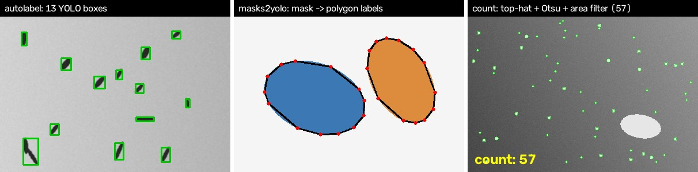

# vision-data-tools

[](https://github.com/LinRungChi/vision-data-tools/actions)
[](LICENSE)

Small tools I kept rewriting while building vision datasets for lab
experiments: record frames from an industrial camera, bootstrap labels without
manual drawing, convert masks to YOLO polygons, split the dataset, and count
particles in microscopy video. Each is one short module with no framework
around it.


*Synthetic examples, generated by `examples/make_figure.py`.*

| Command | What it does | Module |
|---|---|---|
| `vdt capture` | Live preview and recording from a Basler camera (pylon) or any OpenCV camera; each run goes to a new dated session folder | `capture.py` |
| `vdt caminfo` | Model, resolution, pixel format and frame-rate limit of every connected Basler camera | `capture.py` |
| `vdt autolabel` | YOLO box labels for objects darker (or brighter) than a back-lit background: threshold → morphology → connected regions | `autolabel.py` |
| `vdt masks2yolo` | Class-index masks (from Blender renders, SAM, labelling tools) → YOLO segmentation polygons, with class remapping | `masks.py` |
| `vdt split` | Train/val/test split with `data.yaml`; unlabelled images kept as background samples | `split.py` |
| `vdt count` | Per-frame particle count in microscopy video: white top-hat → Otsu → opening → area window; CSV + annotated video | `count.py` |

All image I/O goes through `imdecode`/`imencode`, so paths with Chinese
characters work on Windows (plain `cv2.imread` fails on them).

## Install

```bash
pip install -e .            # numpy + opencv
pip install -e ".[pylon]"   # + Basler camera support
pip install -e ".[dev]" && pytest -q
```

## Usage

```bash
# 1. record: r = start/stop, s = single frame, q = quit
vdt capture --source pylon --out recordings --interval 0.5
vdt capture --source 0 --out recordings              # webcam

# 2. bootstrap labels for dark objects on a bright background, with previews to review
vdt autolabel recordings/2026-10-14/session_1 labels --threshold 60 --min-area 80 --preview preview

# or convert segmentation masks (pixel value = class) to YOLO polygons; mask value 1 -> class 0, 2 -> class 1
vdt masks2yolo masks labels --remap 1:0,2:1

# 3. split for training
vdt split recordings/2026-10-14/session_1 labels dataset --names fry --ratios 0.8,0.1,0.1
yolo train data=dataset/data.yaml model=yolo11n.pt          # e.g. with Ultralytics

# 4. count particles in a microscopy video
vdt count sample.mp4 --csv counts.csv --out-video counted.mp4 --kernel 15 --min-area 5 --max-area 100
```

As a library:

```python
from vision_data_tools.autolabel import ThresholdLabeler
from vision_data_tools.count import ParticleCounter

boxes = ThresholdLabeler(threshold=60, min_area=80).boxes(img)        # [(x, y, w, h), ...]
n, mask = ParticleCounter(tophat_kernel=15).count(gray)
```

## Notes

- `autolabel` is for bootstrapping: train a first detector on its output,
  then correct the labels where the detector and the threshold disagree.
- `masks2yolo` uses outer contours only; YOLO's polygon format cannot
  represent holes.
- Choose the top-hat kernel a little larger than the largest particle;
  `--max-area` rejects debris and clumps.

## References

- N. Otsu. *A Threshold Selection Method from Gray-Level Histograms.* IEEE Transactions on Systems, Man, and Cybernetics 9(1), 1979. (`count`)
- Label files follow the [Ultralytics YOLO](https://docs.ultralytics.com/datasets/) detection and segmentation formats; no Ultralytics code is included.
- Basler cameras are accessed through [pypylon](https://github.com/basler/pypylon) (optional dependency).

## License

MIT © Rung-Chi Lin
